# Backlog

Work for the whole system, derived from the spec (`spec/technical-requirements.md` §1–§10). Cards live in `plan/`,
rulings in `00-decisions.md`, role artifacts in `work/<card>/`. Rules for picking, writing and closing: `CLAUDE.md`.

## Status summary

| Epic             | File                                                 | Done   | Partial | Open   | Total   |
| ---------------- | ---------------------------------------------------- | ------ | ------- | ------ | ------- |
| E1 Todos         | [plan/E1-todos.md](plan/E1-todos.md)                 | 59     | 0       | 36     | 95      |
| E2 Todos plus    | [plan/E2-todos-plus.md](plan/E2-todos-plus.md)       | 5      | 0       | 0      | 5       |
| E3 Todos polish  | [plan/E3-todos-polish.md](plan/E3-todos-polish.md)   | 3      | 0       | 0      | 3       |
| E4 Todos details | [plan/E4-todos-details.md](plan/E4-todos-details.md) | 3      | 0       | 1      | 4       |
| E5 Todos keys    | [plan/E5-todos-keys.md](plan/E5-todos-keys.md)       | 6      | 0       | 0      | 6       |
| E6 Todos cues    | [plan/E6-todos-cues.md](plan/E6-todos-cues.md)       | 4      | 0       | 2      | 6       |
| **Total**        |                                                      | **80** | **0**   | **39** | **119** |

## Execution order

```mermaid
flowchart TD
  S1["1 · List, create, toggle<br/>~~B1.1~~"]
  S2["2 · Edit a title<br/>~~B1.2~~"]
  S3["3 · Clear completed<br/>~~B1.3~~"]
  S1 --> S2
  S4["4 · Mutation failure feedback<br/>~~B1.4~~"]
  S1 --> S3
  S3 --> S4
  S5["5 · Create failure feedback<br/>~~B1.5~~"]
  S4 --> S5
  S6["6 · Log swallowed failures<br/>~~B1.6~~"]
  S5 --> S6
  S7["7 · Kill mutation survivors<br/>~~B1.7~~"]
  S6 --> S7
  S8["8 · Log Prisma errorCode<br/>~~B1.8~~"]
  S6 --> S8
  S9["9 · Redact every password form<br/>~~B1.9~~"]
  S8 --> S9
  S10["10 · E2E failed create keeps title<br/>~~B1.10~~"]
  S5 --> S10
  S11["11 · Redact password as written<br/>~~B1.11~~"]
  S9 --> S11
  S12["12 · card-status.sh whole paragraph<br/>~~B1.12~~"]
  S13["13 · worktree-prune.sh every layout<br/>~~B1.13~~"]
  S14["14 · worktree-prune.sh keeps a net-empty branch<br/>~~B1.14~~"]
  S15["15 · compose project from every checkout<br/>~~B1.15~~"]
  S16["16 · lead time and change failure baseline<br/>~~B1.16~~"]
  S17["17 · plan-scope hook<br/>~~B1.17~~"]
  S18["18 · WIP limit<br/>~~B1.18~~"]
  S19["19 · git hooks in every worktree<br/>~~B1.19~~"]
  S20["20 · plan-scope literal match<br/>~~B1.20~~"]
  S21["21 · draft PR, ping, current branches<br/>~~B1.21~~"]
  S22["22 · batch review and lane metrics<br/>~~B1.22~~"]
  S21 --> S22
  S19 --> S21
  S17 --> S18
  S16 --> S17
  S23["23 · filter All / Active / Completed<br/>~~B2.1~~"]
  S24["24 · remaining count<br/>~~B2.2~~"]
  S25["25 · mark all complete<br/>~~B2.3~~"]
  S26["26 · due date (migration)<br/>~~B2.4~~"]
  S27["27 · search by title<br/>~~B2.5~~"]
  S28["28 · overdue marker<br/>~~B3.1~~"]
  S29["29 · title counter<br/>~~B3.2~~"]
  S30["30 · delete a todo<br/>~~B3.3~~"]
  S31["31 · sessions run their PR steps<br/>~~B1.23~~"]
  S32["32 · guard-bash every forced push<br/>~~B1.24~~"]
  S33["33 · created date<br/>~~B4.1~~"]
  S34["34 · clear search<br/>~~B4.2~~"]
  S35["35 · all done<br/>~~B4.3~~"]
  S36["36 · verify-red escaped titles<br/>~~B1.25~~"]
  S37["37 · pr-step closing PR<br/>~~B1.26~~"]
  S38["38 · next-task quoted titles<br/>~~B1.27~~"]
  S39["39 · guides name batch 4 modules<br/>~~B1.28~~"]
  S40["40 · verify-red base run<br/>~~B1.29~~"]
  S41["41 · guard-bash shell words<br/>B1.30"]
  S42["42 · root guides cite sections<br/>~~B1.31~~"]
  S43["43 · plan-scope glob per segment<br/>~~B1.32~~"]
  S44["44 · CI runs hook-smoke<br/>~~B1.33~~"]
  S45["45 · guide headings cite sections<br/>B1.34"]
  S46["46 · guard for guide § cells<br/>B1.35"]
  S47["47 · hook-smoke gate probe base<br/>B1.36"]
  S48["48 · hook-smoke ignores HEAD_SHA<br/>B1.37"]
  S49["49 · pr-step ci titles<br/>B1.38"]
  S50["50 · plan-deviations uses plan_lists<br/>B1.39"]
  S51["51 · next-task --check uses plan_lists<br/>B1.40"]
  S52["52 · guides state the token rule<br/>B1.41"]
  S53["53 · section 22 criteria gaps<br/>B4.4"]
  S54["54 · spike headless dev-lead<br/>~~B1.42~~"]
  S55["55 · agent-ready eligibility<br/>~~B1.43~~"]
  S56["56 · agent runner<br/>~~B1.44~~"]
  S57["57 · pr evidence and feature map<br/>~~B1.45~~"]
  S58["58 · layer rules in CI<br/>~~B1.46~~"]
  S59["59 · runner card takes spike findings<br/>~~B1.47~~"]
  S60["60 · CI runs eligibility probes<br/>B1.48"]
  S61["61 · live eligibility check<br/>~~B1.49~~"]
  S62["62 · client rule covers prisma client<br/>B1.50"]
  S63["63 · feature map reaches the board<br/>B1.51"]
  S64["64 · dev-lead fills pr evidence<br/>B1.52"]
  S65["65 · CI runs feature-map probes<br/>B1.53"]
  S66["66 · feature map card field and folds<br/>B1.54"]
  S67["67 · agent-ready plan gate<br/>~~B1.55~~"]
  S68["68 · gate resume on the issue<br/>B1.56"]
  S69["69 · unattended and no-rework metrics<br/>~~B1.57~~"]
  S70["70 · runner devcontainer firewall<br/>~~B1.58~~"]
  S71["71 · launchd poll in the sandbox<br/>B1.59"]
  S72["72 · CI runs the runner probes<br/>B1.60"]
  S73["73 · runner deny list and TERM<br/>B1.61"]
  S74["74 · eligibility by label node id<br/>~~B1.63~~"]
  S75["75 · eligibility refuses a closed issue<br/>~~B1.64~~"]
  S76["76 · runner prompt follows D-27<br/>~~B1.65~~"]
  S77["77 · runner image engines and browser<br/>~~B1.62~~"]
  S78["78 · plan for run log retention<br/>B1.66"]
  S79["79 · CI token proof runs the timeline query<br/>B1.67"]
  S80["80 · runner container keeps a git identity<br/>~~B1.69~~"]
  S81["81 · firewall reads GitHub ranges with a token<br/>B1.70"]
  S82["82 · worktree.sh stops without a Prisma client<br/>B1.71"]
  S83["83 · scripts guide lists probes S1–S10<br/>B1.72"]
  S84["84 · runner setup checks out an existing branch<br/>B1.73"]
  S85["85 · dev-lead commits a formatted review.md<br/>~~B1.74~~"]
  S86["86 · PR wrapper keeps the runner's git credential<br/>~~B1.76~~"]
  S87["87 · guard-bash blocks printing a git or gh credential<br/>B1.77"]
  S88["88 · overdue count<br/>~~B5.1~~"]
  S89["89 · Escape cancels a title edit<br/>~~B5.2~~"]
  S90["90 · slash focuses search<br/>~~B5.3~~"]
  S91["91 · tab title shows the count<br/>~~B5.4~~"]
  S92["92 · Escape clears search<br/>~~B5.5~~"]
  S93["93 · Escape closes the due-date editor<br/>~~B5.6~~"]
  S94["94 · dev-lead write guard stops at dev-lead headless<br/>~~B1.78~~"]
  S95["95 · build roles write files with Write/Edit, not Bash text<br/>~~B1.79~~"]
  S96["96 · components guide: search form is a client component<br/>B1.80"]
  S90 --> S96
  S97["97 · .env.example no longer exempts a whole command<br/>B1.81"]
  S98["98 · run.sh skips issues while merged agent branches remain<br/>~~B1.82~~"]
  S99["99 · unattended.sh tells the runner's ready from a person's<br/>~~B1.83~~"]
  S100["100 · reviewer probes refuse to write without TMPDIR<br/>~~B1.84~~"]
  S101["101 · plans give the docs(map) step to code-writer<br/>~~B1.85~~"]
  S102["102 · check-ac-coverage reads multi-line it.each titles<br/>~~B1.86~~"]
  S103["103 · docs follow B1.83's label and touches column<br/>B1.87"]
  S99 --> S103
  S104["104 · the runner gives each run a private TMPDIR<br/>~~B1.88~~"]
  S100 --> S104
  S105["105 · parallel runner PRs merge appended table rows<br/>~~B1.89~~"]
  S106["106 · hook-smoke keeps the docs(map) step with code-writer<br/>B1.90"]
  S101 --> S106
  S107["107 · the closing lane checks the map row, never flips it<br/>B1.91"]
  S101 --> S107
  S108["108 · Loop 9 runs the table guards after a clean merge<br/>B1.92"]
  S105 --> S108
  S109["109 · smokes check mktemp before their exit trap<br/>B1.93"]
  S110["110 · CI runs table-merge-smoke, host attributes out<br/>B1.94"]
  S105 --> S110
  S111["111 · Escape clears the new-todo title<br/>~~B6.1~~"]
  S112["112 · filter links show their counts<br/>~~B6.2~~"]
  S113["113 · an open todo due today says so<br/>~~B6.3~~"]
  S114["114 · clear-completed says how many<br/>~~B6.4~~"]
  S115["115 · overdue count announced<br/>B6.5"]
  S116["116 · remaining count announced<br/>B6.6"]
  S117["117 · run.sh refuses a clone behind origin/main<br/>B1.95"]
  S118["118 · section index merges by union, duplicate § named<br/>~~B1.96~~"]
  S105 --> S118
  S119["119 · shared tables keep their padding when a row is wider<br/>B1.97"]
  S118 --> S119
```

## Remaining

Board state (To do · Doing · Review · Closing) is derived, not typed: `scripts/next-task.sh --list` (BOARD column),
at most 3 cards Doing (B1.18).

| Step | ID    | Title                                                                                                     | Spec § | Status | Blocked by                      | Owner | Size         |
| ---- | ----- | --------------------------------------------------------------------------------------------------------- | ------ | ------ | ------------------------------- | ----- | ------------ |
| 41   | B1.30 | guard-bash reads shell words before matching a push                                                       | —      | Open   | —                               | Lead  | S [estimate] |
| 45   | B1.34 | Package guide headings and the app page header cite the sections their modules name                       | —      | Open   | —                               | Lead  | S [estimate] |
| 46   | B1.35 | A guard checks that the guide tables cite the sections their packages name                                | —      | Open   | —                               | Lead  | S [estimate] |
| 47   | B1.36 | hook-smoke's review-gate probe judges "clean" from the gate's own base                                    | —      | Open   | —                               | Lead  | S [estimate] |
| 48   | B1.37 | hook-smoke's check-plan-scope probes ignore an exported HEAD_SHA and BASE_SHA                             | —      | Open   | —                               | Lead  | S [estimate] |
| 49   | B1.38 | pr-step accepts the ci type that commit-msg accepts                                                       | —      | Open   | —                               | Lead  | S [estimate] |
| 50   | B1.39 | plan-deviations judges a merged PR's files by the guard's plan_lists rule                                 | —      | Open   | —                               | Lead  | S [estimate] |
| 51   | B1.40 | next-task --check reads plan tokens by the plan_lists rule                                                | —      | Open   | —                               | Lead  | S [estimate] |
| 52   | B1.41 | Guides state the plan-token rule and name hook-smoke's L1–L15                                             | —      | Open   | —                               | Lead  | S [estimate] |
| 53   | B4.4  | Section 22 criteria measure the reload rule and the no-role rule                                          | —      | Open   | —                               | Lead  | S [estimate] |
| 60   | B1.48 | CI runs the agent-ready eligibility probes                                                                | —      | Open   | ~~B1.43~~                       | Lead  | S [estimate] |
| 62   | B1.50 | The client layer rule also stops a component reaching @prisma/client                                      | —      | Open   | ~~B1.46~~                       | Lead  | S [estimate] |
| 63   | B1.51 | The daily feature map reaches the agent board and its PRs carry a tier                                    | —      | Open   | ~~B1.44~~                       | Lead  | S [estimate] |
| 64   | B1.52 | dev-lead fills the PR Evidence section after CI is green                                                  | —      | Open   | ~~B1.45~~                       | Lead  | S [estimate] |
| 65   | B1.53 | CI runs the feature-map probes                                                                            | —      | Open   | ~~B1.45~~                       | Lead  | S [estimate] |
| 66   | B1.54 | The feature map reads the issue form's card field, warns when it truncates, and folds before it trims     | —      | Open   | ~~B1.45~~                       | Lead  | S [estimate] |
| 68   | B1.56 | A high-tier gate stop resumes when the lead approves on the issue                                         | —      | Open   | ~~B1.44~~, ~~B1.55~~            | Lead  | S [estimate] |
| 71   | B1.59 | A launchd job runs the runner's poll every 15 minutes, inside the sandbox                                 | —      | Open   | ~~B1.44~~, ~~B1.58~~, ~~B1.62~~ | Lead  | S [estimate] |
| 72   | B1.60 | CI runs the runner and tier probes, under bash 5 as well                                                  | —      | Open   | ~~B1.44~~                       | Lead  | S [estimate] |
| 73   | B1.61 | The runner's deny list spares commit messages, and TERM ends the tools a run started                      | —      | Open   | ~~B1.44~~                       | Lead  | S [estimate] |
| 78   | B1.66 | A plan for how long the runner keeps its run logs                                                         | —      | Open   | —                               | Lead  | S [estimate] |
| 79   | B1.67 | CI's token proof runs the eligibility check's timeline query, and the scripts guide states its rules      | —      | Open   | ~~B1.63~~                       | Lead  | S [estimate] |
| 81   | B1.70 | The runner firewall reads GitHub's ranges with a token, so a restart never hits the anonymous rate limit  | —      | Open   | ~~B1.58~~                       | Lead  | S [estimate] |
| 82   | B1.71 | worktree.sh stops when the Prisma client was not generated                                                | —      | Open   | ~~B1.62~~                       | Lead  | S [estimate] |
| 83   | B1.72 | The scripts guide lists sandbox probes S1–S10                                                             | —      | Open   | ~~B1.62~~                       | Lead  | S [estimate] |
| 84   | B1.73 | The runner's setup steps check out a branch that exists                                                   | —      | Open   | ~~B1.69~~                       | Lead  | S [estimate] |
| 87   | B1.77 | guard-bash blocks commands that print a git or gh credential                                              | —      | Open   | —                               | Lead  | S [estimate] |
| 96   | B1.80 | The components guide says the search form is a client component once section 25 lands                     | —      | Open   | ~~B5.3~~                        | Lead  | S [estimate] |
| 97   | B1.81 | guard-bash's secret-read rule lets any command through once it names `.env.example`                       | —      | Open   | —                               | Lead  | S [estimate] |
| 103  | B1.87 | Docs still describe unattended.sh and pr-step.sh as they were before B1.83                                | —      | Open   | —                               | Lead  | S [estimate] |
| 106  | B1.90 | Nothing in CI keeps the `docs(map)` step with code-writer                                                 | —      | Open   | —                               | Lead  | S [estimate] |
| 107  | B1.91 | The closing lane still flips the feature's map row, which the card's own `docs(map)` commit already moved | —      | Open   | —                               | Lead  | S [estimate] |
| 108  | B1.92 | A union merge's duplicate row reaches CI before any guard reads it                                        | —      | Open   | ~~B1.89~~                       | Lead  | S [estimate] |
| 109  | B1.93 | Eight smokes remove the caller's directory when `mktemp -d` fails                                         | —      | Open   | —                               | Lead  | S [estimate] |
| 110  | B1.94 | CI never runs table-merge-smoke, whose verdict follows the host's own git attributes                      | —      | Open   | ~~B1.89~~                       | Lead  | S [estimate] |
| 115  | B6.5  | The overdue count is announced to assistive technology                                                    | —      | Open   | ~~D-33~~                        | Lead  | S [estimate] |
| 116  | B6.6  | The remaining count is announced to assistive technology                                                  | —      | Open   | ~~D-33~~, ~~D-35~~, ~~D-36~~    | Lead  | S [estimate] |
| 117  | B1.95 | run.sh runs its own scripts from a clone behind origin/main and never says so                             | —      | Open   | —                               | Lead  | S [estimate] |
| 119  | B1.97 | A row wider than its column makes Prettier re-pad the whole shared table                                  | —      | Open   | ~~B1.96~~                       | Lead  | S [estimate] |

## Waiting on human

| ID  | What | Blocks |
| --- | ---- | ------ |
