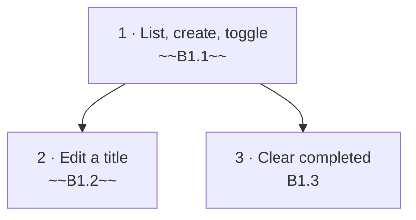

# Backlog

Work for the whole system, derived from the spec (`spec/technical-requirements.md` §1–§8). Cards live in `plan/`,
rulings in `00-decisions.md`, role artifacts in `work/<card>/`. Rules for picking, writing and closing: `CLAUDE.md`.

## Status summary

| Epic      | File                                 | Done  | Partial | Open  | Total |
| --------- | ------------------------------------ | ----- | ------- | ----- | ----- |
| E1 Todos  | [plan/E1-todos.md](plan/E1-todos.md) | 2     | 0       | 1     | 3     |
| **Total** |                                      | **2** | **0**   | **1** | **3** |

## Execution order

## Remaining

| Step | ID   | Title                 | Spec § | Status | Blocked by | Owner | Size         |
| ---- | ---- | --------------------- | ------ | ------ | ---------- | ----- | ------------ |
| 3    | B1.3 | Clear completed todos | §9     | Open   | ~~B1.1~~   | Lead  | S [estimate] |

## Waiting on human

| ID  | What | Blocks |
| --- | ---- | ------ |
