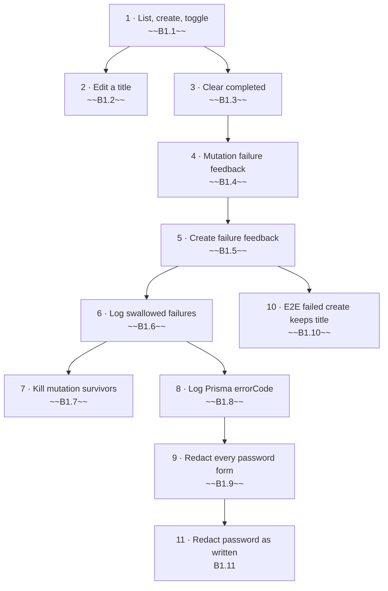

# Backlog

Work for the whole system, derived from the spec (`spec/technical-requirements.md` §1–§10). Cards live in `plan/`,
rulings in `00-decisions.md`, role artifacts in `work/<card>/`. Rules for picking, writing and closing: `CLAUDE.md`.

## Status summary

| Epic      | File                                 | Done   | Partial | Open  | Total  |
| --------- | ------------------------------------ | ------ | ------- | ----- | ------ |
| E1 Todos  | [plan/E1-todos.md](plan/E1-todos.md) | 10     | 0       | 1     | 11     |
| **Total** |                                      | **10** | **0**   | **1** | **11** |

## Execution order

## Remaining

| Step | ID    | Title                                                             | Spec § | Status | Blocked by     | Owner | Size         |
| ---- | ----- | ----------------------------------------------------------------- | ------ | ------ | -------------- | ----- | ------------ |
| 11   | B1.11 | Redact the database password exactly as written in `DATABASE_URL` | §11    | Open   | ~~B1.9~~, D-17 | Lead  | S [estimate] |

## Waiting on human

| ID   | What                                                                                                                                                                                                                                            | Blocks |
| ---- | ----------------------------------------------------------------------------------------------------------------------------------------------------------------------------------------------------------------------------------------------- | ------ |
| D-17 | §11 REQ-11.4 "as written" vs the parser-normalized forms in its Function contracts: A also redact the raw-text forms; B reword REQ-11.4 to the parser forms (Tier 0); C list the gap as out of scope. Request: `work/B1.11/decision-request.md` | B1.11  |
