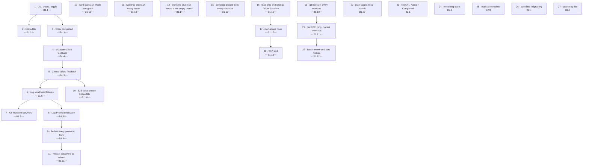

# Backlog

Work for the whole system, derived from the spec (`spec/technical-requirements.md` §1–§10). Cards live in `plan/`,
rulings in `00-decisions.md`, role artifacts in `work/<card>/`. Rules for picking, writing and closing: `CLAUDE.md`.

## Status summary

| Epic          | File                                           | Done   | Partial | Open  | Total  |
| ------------- | ---------------------------------------------- | ------ | ------- | ----- | ------ |
| E1 Todos      | [plan/E1-todos.md](plan/E1-todos.md)           | 21     | 0       | 1     | 22     |
| E2 Todos plus | [plan/E2-todos-plus.md](plan/E2-todos-plus.md) | 0      | 0       | 5     | 5      |
| **Total**     |                                                | **21** | **0**   | **6** | **27** |

## Execution order

## Remaining

Board state (To do · Doing · Review · Closing) is derived, not typed: `scripts/next-task.sh --list` (BOARD column),
at most 3 cards Doing (B1.18).

| Step | ID    | Title                                                                      | Spec §                 | Status | Blocked by | Owner | Size         |
| ---- | ----- | -------------------------------------------------------------------------- | ---------------------- | ------ | ---------- | ----- | ------------ |
| 20   | B1.20 | Plan rows with `[ ]` match their own path in the plan-scope hook and guard | —                      | Open   | ~~B1.17~~  | Lead  | S [estimate] |
| 23   | B2.1  | Filter the list: All / Active / Completed                                  | new, section 12 (D-20) | Open   | —          | Lead  | S [estimate] |
| 24   | B2.2  | Show how many todos remain                                                 | new, section 13 (D-20) | Open   | —          | Lead  | S [estimate] |
| 25   | B2.3  | Mark all todos complete                                                    | new, section 14 (D-20) | Open   | —          | Lead  | S [estimate] |
| 26   | B2.4  | An optional due date per todo                                              | new, section 15 (D-20) | Open   | —          | Lead  | M [estimate] |
| 27   | B2.5  | Search todos by title                                                      | new, section 16 (D-20) | Open   | —          | Lead  | S [estimate] |

## Waiting on human

| ID  | What | Blocks |
| --- | ---- | ------ |
