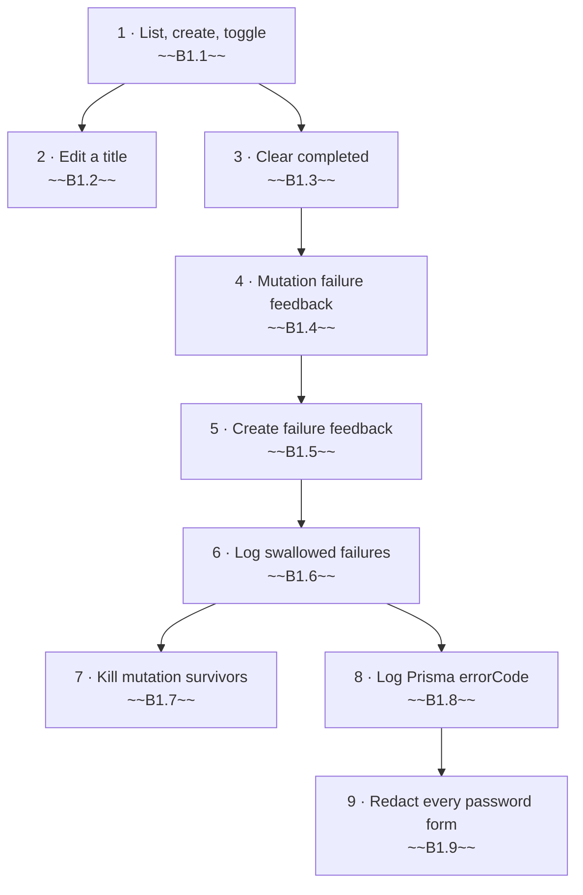

# Backlog

Work for the whole system, derived from the spec (`spec/technical-requirements.md` §1–§10). Cards live in `plan/`,
rulings in `00-decisions.md`, role artifacts in `work/<card>/`. Rules for picking, writing and closing: `CLAUDE.md`.

## Status summary

| Epic      | File                                 | Done  | Partial | Open  | Total |
| --------- | ------------------------------------ | ----- | ------- | ----- | ----- |
| E1 Todos  | [plan/E1-todos.md](plan/E1-todos.md) | 9     | 0       | 0     | 9     |
| **Total** |                                      | **9** | **0**   | **0** | **9** |

## Execution order

## Remaining

| Step | ID  | Title | Spec § | Status | Blocked by | Owner | Size |
| ---- | --- | ----- | ------ | ------ | ---------- | ----- | ---- |

## Waiting on human

| ID  | What | Blocks |
| --- | ---- | ------ |
