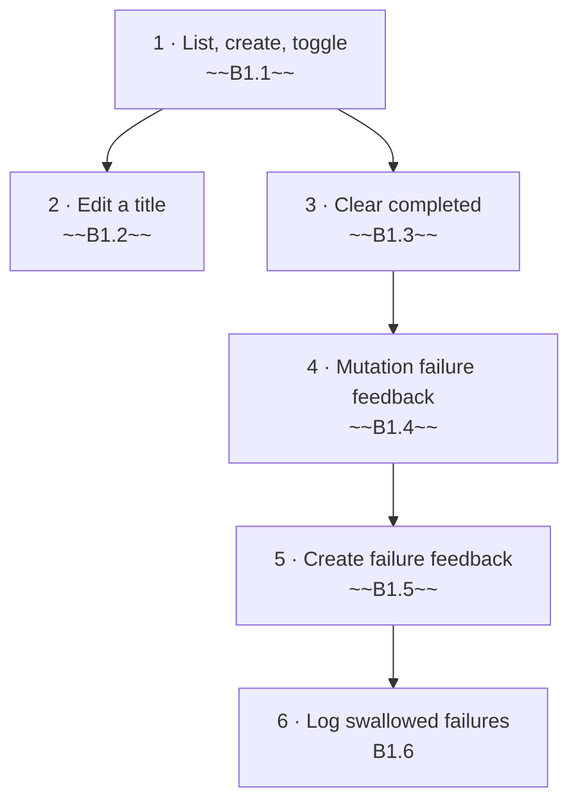

# Backlog

Work for the whole system, derived from the spec (`spec/technical-requirements.md` §1–§10). Cards live in `plan/`,
rulings in `00-decisions.md`, role artifacts in `work/<card>/`. Rules for picking, writing and closing: `CLAUDE.md`.

## Status summary

| Epic      | File                                 | Done  | Partial | Open  | Total |
| --------- | ------------------------------------ | ----- | ------- | ----- | ----- |
| E1 Todos  | [plan/E1-todos.md](plan/E1-todos.md) | 5     | 0       | 1     | 6     |
| **Total** |                                      | **5** | **0**   | **1** | **6** |

## Execution order

## Remaining

| Step | ID   | Title                           | Spec § | Status | Blocked by | Owner | Size         |
| ---- | ---- | ------------------------------- | ------ | ------ | ---------- | ----- | ------------ |
| 6    | B1.6 | Log swallowed mutation failures | §11    | Open   | ~~B1.5~~   | Lead  | S [estimate] |

## Waiting on human

| ID   | What                                                                                                                                                                    | Blocks |
| ---- | ----------------------------------------------------------------------------------------------------------------------------------------------------------------------- | ------ |
| D-12 | Logger sink and what a log may contain (A in-repo stderr JSON / B console.error / C dependency; R2 scrub vs R3 name+code only) — `work/B1.6/analysis.md` Needs a ruling | B1.6   |
